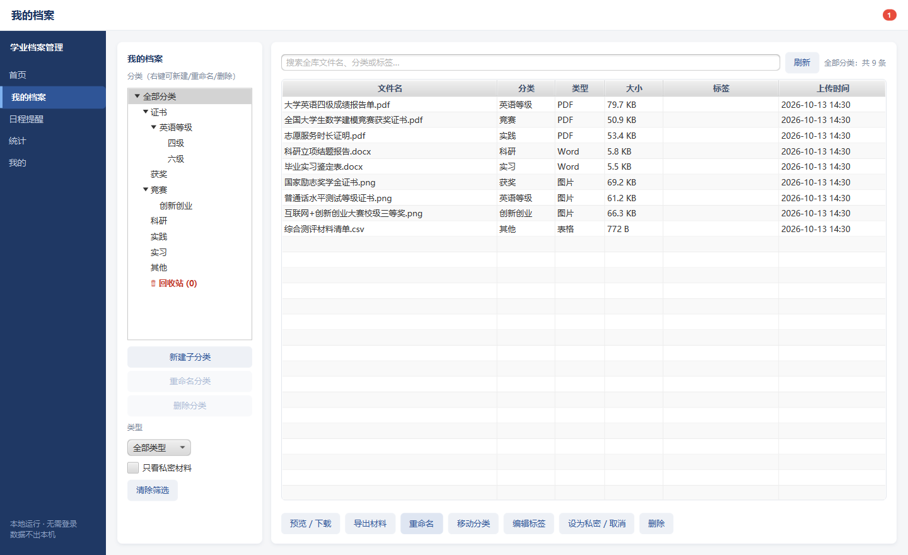
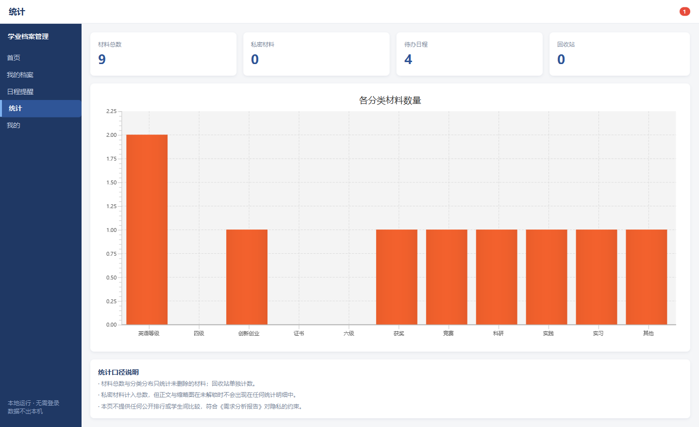
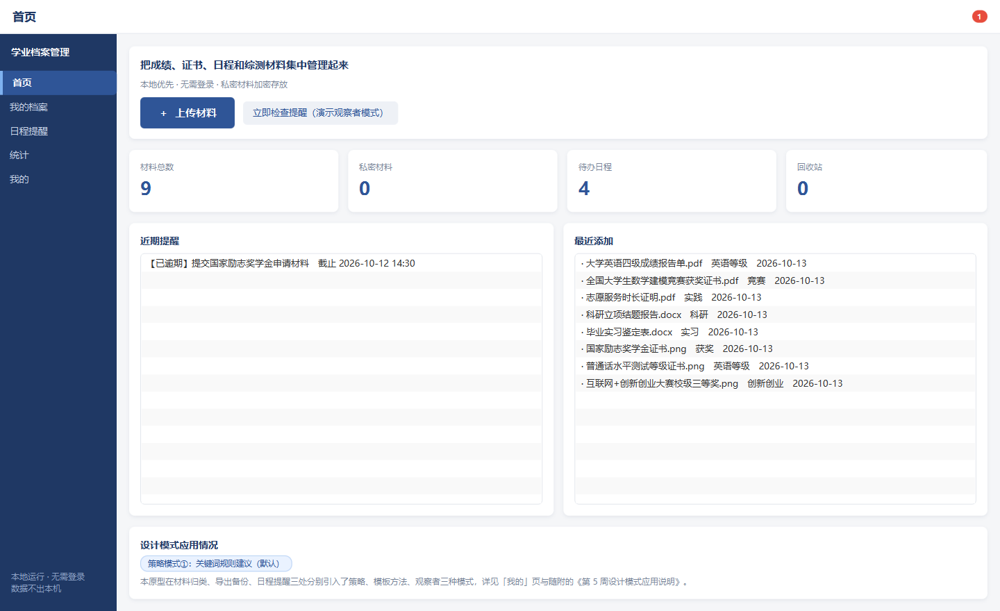
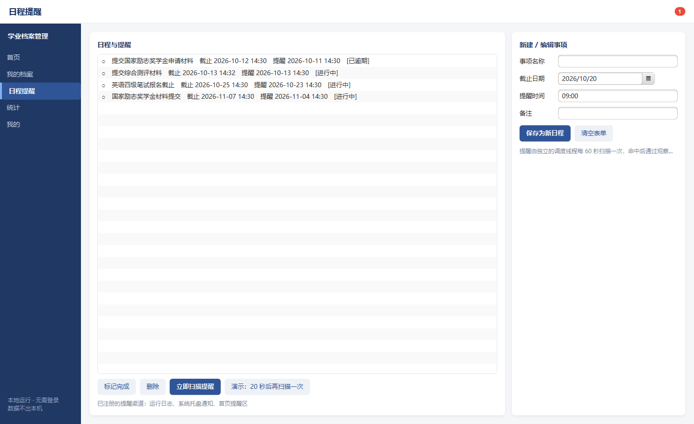
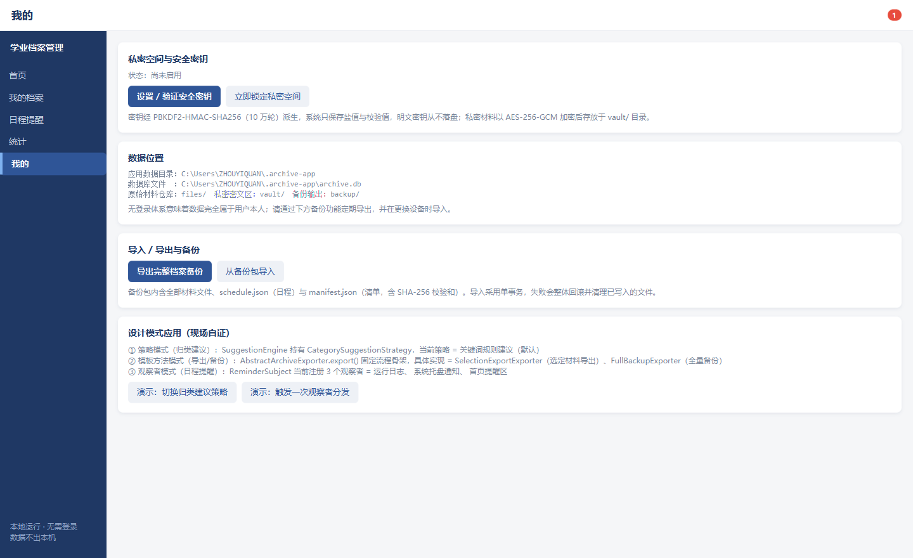

# 大学生个人学业档案与证书日程管理系统

> 一个只存在你自己电脑上的学业材料抽屉。零账号、零联网；材料放进去自动归类，要用时一句话搜出来，敏感的那几份单独上锁。

软件体系结构课程项目 · MVP 原型

---

## 为什么做这个

在校学生每个学期都在为同一件事发愁：材料散落在相册、微信、U 盘和电脑桌面，综测通知下来只有三天，翻遍所有地方还是漏了一份获奖证书；而成绩单、身份证这类东西又不敢往网盘传。

试过的办法都只解决了一个环节：

| 办法 | 只解决了 |
|---|---|
| 手机相册 | 存 —— 但和电脑不同步、搜不了 |
| 微信文件传输助手 | 传 —— 但文件会过期 |
| 电脑建文件夹 | 放 —— 但要自己想分类名，换电脑就乱 |
| 商业网盘 | 方便 —— 但要实名，敏感材料不敢传 |

本项目要的是一个**完全本地、不需要账号**的工具：自动归类、全库检索、敏感材料加密、重要日程提醒，而且这些能力都要**能被验证**——不是"我们说要保护你的隐私"。

## 快速开始

```bat
:: 一键启动（推荐演示用）
run.bat

:: 或走 Maven
mvn -q javafx:run
mvn -q test          :: 运行全部单元测试
mvn -q package       :: 打包
```

**环境要求**：JDK 17 或更高、Maven 3.6+、Windows 10/11。
JavaFX 与其余依赖由 Maven 自动下载，无需手工安装 SDK。

**首次启动**会自动生成 9 份真实格式的示例材料（真 PDF / 真 DOCX / 真 PNG / 真 CSV）、一棵两层分类树与 3 条日程，其中一条 20 秒后触发提醒，便于直接进入演示。

## 功能

| 模块 | 说明 |
|---|---|
| 材料上传 | 批量上传，按文件名与类型给出**归类建议**，用户接受或修改；单文件 ≤ 200 MB、单批 ≤ 200 个 |
| 分类树 | 用户可自建任意层级的分类，支持重命名与删除；删除时材料自动并入父分类 |
| 全库检索 | 关键词跨全库检索，不受当前分类限制；支持分类子树 + 类型 + 私密组合筛选 |
| 回收站 | 软删除保留原分类，可恢复；仅回收站内可永久删除（二次确认） |
| 私密空间 | AES-256-GCM 加密存储，明文立即删除；未解锁读取返回 `E202`，密文篡改返回 `E203` |
| 日程提醒 | 到期事件同时推送至界面通知、系统托盘、运行日志 |
| 材料导出 | 选中若干材料导出为压缩包，包内使用原始文件名，附含 SHA-256 的 `manifest.json` |
| 全量备份 | 导出含日程的完整档案包，支持跨设备导入（单事务，失败整体回滚） |
| 统计概览 | 分类与类型分布、私密数量、回收站条目 |

## 架构

四层分层单体，**单向依赖**，上层只能调下层：

```
表现层  presentation   JavaFX —— 首页 / 我的档案 / 日程提醒 / 统计 / 我的
   ↓
业务逻辑层 service     材料 · 分类树 · 私密安全 · 检索 · 日程 · 导出 · 备份
   ↓
数据访问层 dao         MyBatis 注解映射 —— 6 个 Mapper
   ↓
存储层   storage       SQLite 单文件库（9 张表 / 7 个索引）+ files/ 与 vault/ 文件仓库
```

这条约束是**可验证的**：`service` 包不 import `ui` 包，`dao` 包不 import `service` 包，违反会在编译期直接失败。

## 三个设计模式

都锚定在真实扩展点上，不是为用而用：

| 模式 | 落点 | 现有实现 | 关键类 |
|---|---|---|---|
| **策略** | 材料归类建议算法族 | 3 个：关键词规则 / 扩展名规则 / 不做建议 | `pattern.suggest.SuggestionEngine` |
| **模板方法** | 导出流程骨架，`export()` 声明为 `final` | 2 个：选定材料导出 / 全量档案备份 | `pattern.export.AbstractArchiveExporter` |
| **观察者** | 日程提醒分发 | 3 个：界面通知 / 系统托盘 / 运行日志 | `pattern.reminder.ReminderSubject` |

### 现场自证

打开「我的」页面底部的**设计模式应用（现场自证）**面板：

- 实时显示"当前策略名"与"已注册的观察者列表"——都是运行时真实状态，不是写死的说明文字；
- 「演示：切换归类建议策略」按钮可在运行期替换算法，下次上传立即生效；
- 「演示：触发一次观察者分发」按钮可当场看到一条事件送达全部渠道。

## 安全设计

```
用户安全密钥（明文只在内存）
    │  PBKDF2-HMAC-SHA256，16 字节随机盐，100,000 轮
    ▼
派生密钥 derivedKey（256 位）
    │
    ├──→ SHA-256 ──→ keyHash  ──→ 存入数据库
    └──→ 留在内存 ──→ 用于 AES-256-GCM 加解密文件
```

数据库只保存 **盐 + 校验值 + 迭代轮数**，密钥本身从不落盘。实测：

- 明文中的 `%PDF` 文件头在密文中完全找不到
- 同一份文件加密两次，密文不同（每次生成 12 字节随机 IV）
- 改动密文 1 个比特 → 解密被拒绝
- 派生 37 ms / 次，AES-256-GCM 吞吐 70 MB/s，设为私密端到端 26 ms

## 工程结构

```
src/main/java/com/campus/archive/
├── ArchiveApp.java / Launcher.java     JavaFX 入口（Launcher 用于类路径启动）
├── entity/       9 个实体 + 2 个枚举
├── dto/          Result / Page / 各种请求与结果对象
├── dao/          6 个 MyBatis 注解 Mapper
├── service/      8 个业务接口
├── service/impl/ 8 个实现
├── pattern/
│   ├── suggest/  ★ 设计模式① 策略模式
│   ├── export/   ★ 设计模式② 模板方法模式
│   └── reminder/ ★ 设计模式③ 观察者模式
├── infra/        FileStore / CryptoUtil / MiniJson / LocalDateTimeTypeHandler
├── schedule/     ReminderScheduler 提醒调度线程
├── config/       Database / Repositories / AppContext / DemoDataSeeder
└── ui/           主窗口 + 5 个页面 + 上传与解锁对话框 + 通用构件

src/main/resources/
├── db/schema.sql        SQLite 建表脚本（9 张表 / 7 个索引 / 7 个内置分类）
├── css/app.css          界面样式
└── demo-samples/        首次启动释放的 9 份真实格式示例材料

src/test/java/    12 个测试类 / 69 个用例
```

规模：主代码 **80 个类 / 6,339 行**（有效行 5,347），测试代码 12 个类 / 2,100 行。

## 测试

```bat
mvn -q test
```

| 测试类 | 用例数 | 覆盖 |
| --- | --- | --- |
| `pattern.SuggestionStrategyTest` | 6 | 模式①：规则命中、无命中、策略互换、空对象、运行期切换、新增规则 |
| `pattern.ExportTemplateTest` | 7 | 模式②：骨架 final、步骤顺序、钩子写清单、E400、两子类差异、E202、失效条目跳过 |
| `pattern.ReminderObserverTest` | 6 | 模式③：一对多分发、注销去重、异常隔离、事件历史、并发发布 |
| `infra.CryptoUtilTest` | 6 | 密钥派生、AES-GCM 往返、篡改检测、文件摘要、内存清零、JSON 转义 |
| `service.MaterialServiceTest` | 9 | 上传归类、去重不阻断、批量部分失败、标签检索、删除恢复、永久删除、组合筛选 |
| `service.PrivateSecurityServiceTest` | 9 | 密钥设置校验、只存盐与哈希、锁定、错误密钥通用提示、加解密、未授权访问被拒 |
| `service.CategoryTreeTest` | 9 | 新建嵌套分类、同级重名、子树收集、父分类筛选、删分类时材料迁移、全库搜索 |
| `service.SelectionExportTest` | 6 | 原始文件名、内容一致、manifest 校验和、未解锁拒绝、明文导出、同名不覆盖 |
| `service.TrashFlowTest` | 5 | 普通/回收站互斥、删除时间倒序、恢复原分类、永久删除、计数一致 |
| `service.BackupAndReminderTest` | 6 | 备份结构、跨档案导入、错误包拒绝、私密备份往返、提醒幂等、逾期标记 |
| **合计** | **69** | 全部通过 |

另有**截图模式**用于交付材料与界面回归：

```bat
java -Dsnapshot.dir=docs\screenshots -cp "target\classes;<依赖 classpath>" com.campus.archive.Launcher
```

启动后自动依次切换五个页面并截图，完成后自动退出。

## 数据位置

`%USERPROFILE%\.archive-app\`

```
.archive-app\
├── archive.db          SQLite 数据库（元数据、分类、日程、安全设置）
├── files\yyyy\MM\      原始材料仓库，物理文件名为 {UUID}.{ext}
├── vault\              私密材料密文区（AES-256-GCM）
├── backup\             导出的备份包
└── logs\               运行日志
```

可用 `-Darchive.home=目录` 把数据放到别处。

两个设计决定：

1. **磁盘上的文件名是 UUID，不是原始名**。原名只存在数据库的 `file_name` 字段里。这样既避免中文路径与重名覆盖问题，也让别人直接翻文件仓库时认不出哪份是什么。
2. **分类是自关联的树**（`category.parent_id`），筛选时收集整棵子树的 ID，所以点父分类能看到子分类里的材料。

## 性能实测

本机实测，基准脚本可复跑（24 核 / 4 GB 堆）：

| 场景 | 3 千条 | 2 万条 | 5 万条 |
|---|---|---|---|
| 关键词检索 P50 | 15.6 ms | 67.6 ms | 144.3 ms |
| 组合筛选 | 12.3 ms | 48.1 ms | 96.0 ms |
| 首页「最近添加」 | 6.4 ms | 29.0 ms | 45.6 ms |

其他单次操作：批量上传 50 个文件（3.2 MB）2,231 ms；设为私密 26 ms；导出 52 个文件 1,026 ms；全量备份 53 个文件 7,780 ms；跨档案导入 248 ms。

## 界面

| 我的档案：树形分类 + 全库搜索 + 材料导出 | 统计：分类与类型分布 |
|---|---|
|  |  |

| 首页：常用入口 + 近期提醒 | 日程提醒：三项观察者渠道 |
|---|---|
|  |  |

「我的」页面底部是设计模式的现场自证面板，实时显示当前策略与已注册的观察者：



## 已知限制

项目仍在迭代中，以下是**已定位到具体成因**的缺陷：

| 编号 | 问题 | 成因 |
|---|---|---|
| D1 | 设为私密时，若原文件被其他程序占用，明文删不掉 | 外部阅读器持有文件句柄，Windows 拒绝删除；此时数据库已标记为私密，磁盘上仍留有明文副本 |
| D2 | 预览非图片材料时会直接打开原文件，导致文件被长期占用 | 这是 D1 的根因，两者是同一个问题的两面 |
| D3 | 没有空闲自动锁定；口令强度只要求 ≥ 6 位 | 实测本机派生速度约 44 次/秒，6 位纯数字口令 8 核并行约 0.8 小时可穷举 |
| D4 | 文件类型仅按扩展名识别，不校验文件内容 | 改名即可绕过 |
| D5 | 全量备份耗时为所有操作中最长 | 由元数据总量决定，5 万条元数据下约 7.8 秒 |

**D1 是当前最高优先级的修复项**——它会让"已加密"这个承诺打折扣，虽然功能演示时看不出来。

## 技术栈

| 层次 | 选型 |
| --- | --- |
| 表现层 | JavaFX 21 |
| 业务逻辑层 | Java 17（编译目标），跨层只暴露接口 |
| 数据访问层 | MyBatis 3.5.16（注解映射 + `<script>` 动态 SQL） |
| 存储层 | SQLite 3.46（WAL 模式）+ 本地文件系统 |
| 安全 | JDK 原生 `javax.crypto`：PBKDF2-HMAC-SHA256 + AES-256-GCM |
| 构建与测试 | Maven 3.9 + JUnit 5 |

## 明确的非目标

- 不做学校/教师后台，不做学生之间的公开浏览与排行（隐私约束）；
- 不做账号体系与云同步，数据主权完全属于用户；
- 不模拟官方成绩查询、不抓取任何第三方数据，成绩与证书一律由用户自行录入或上传。
